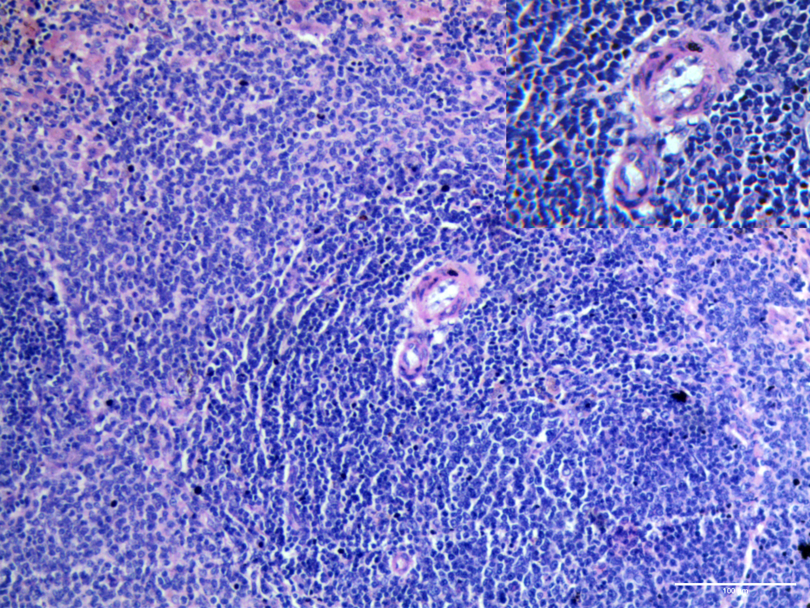
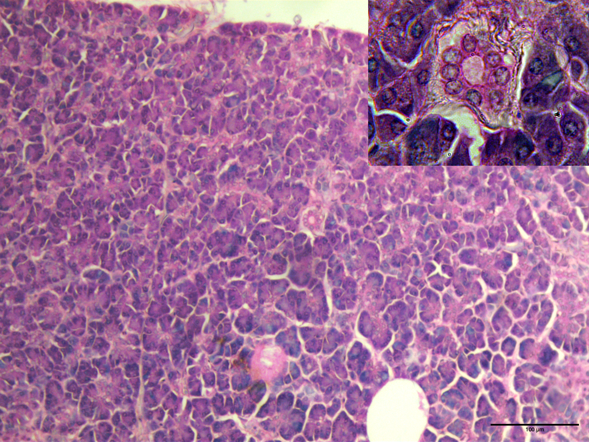
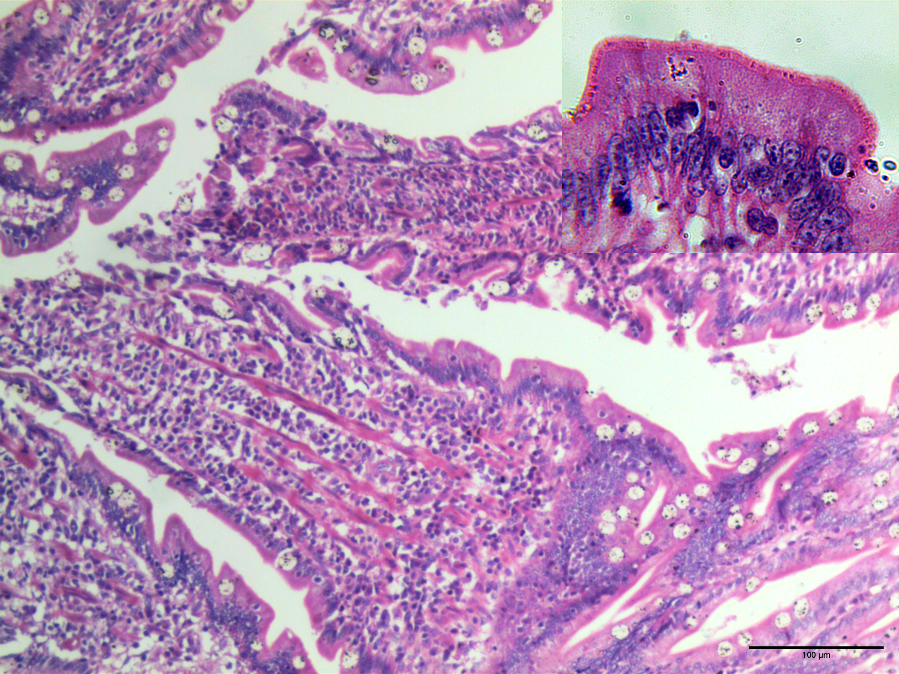
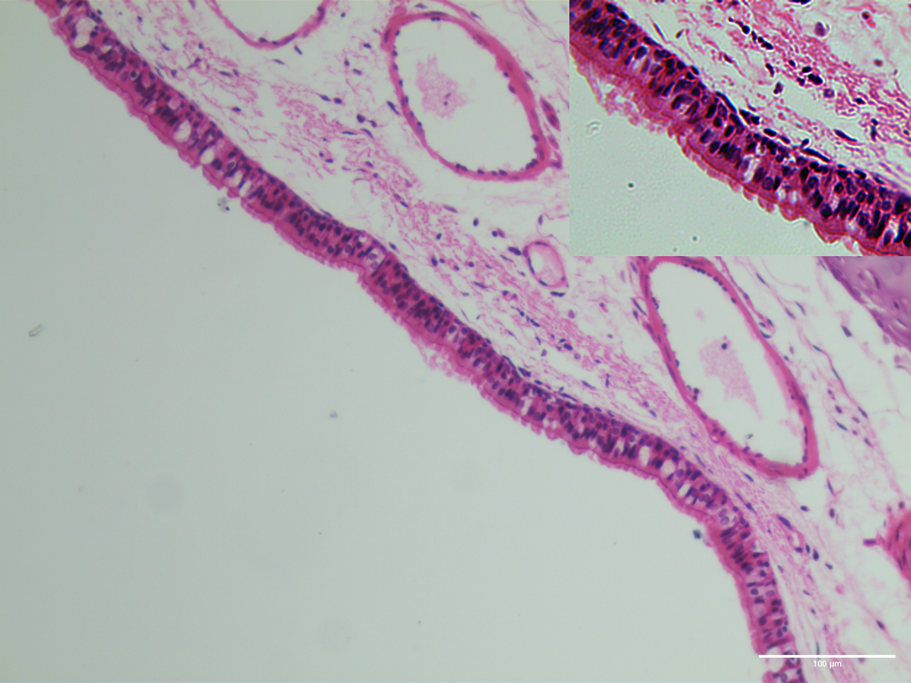
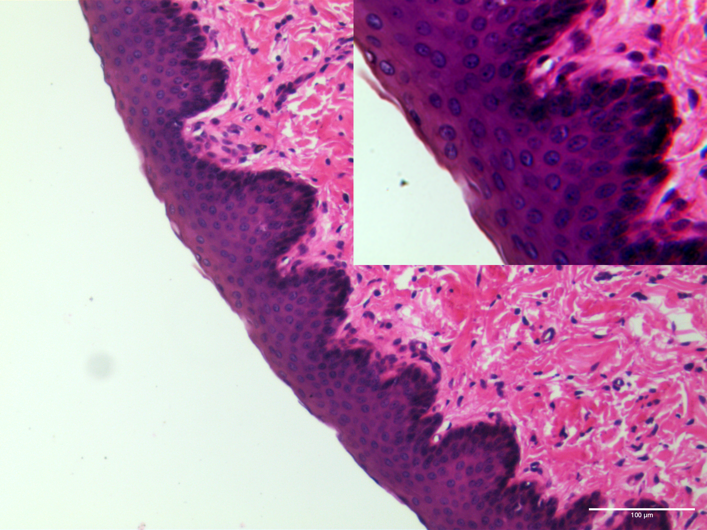
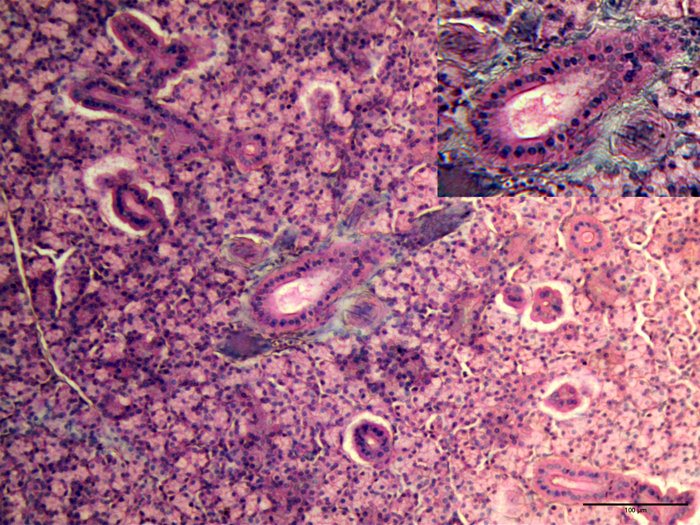
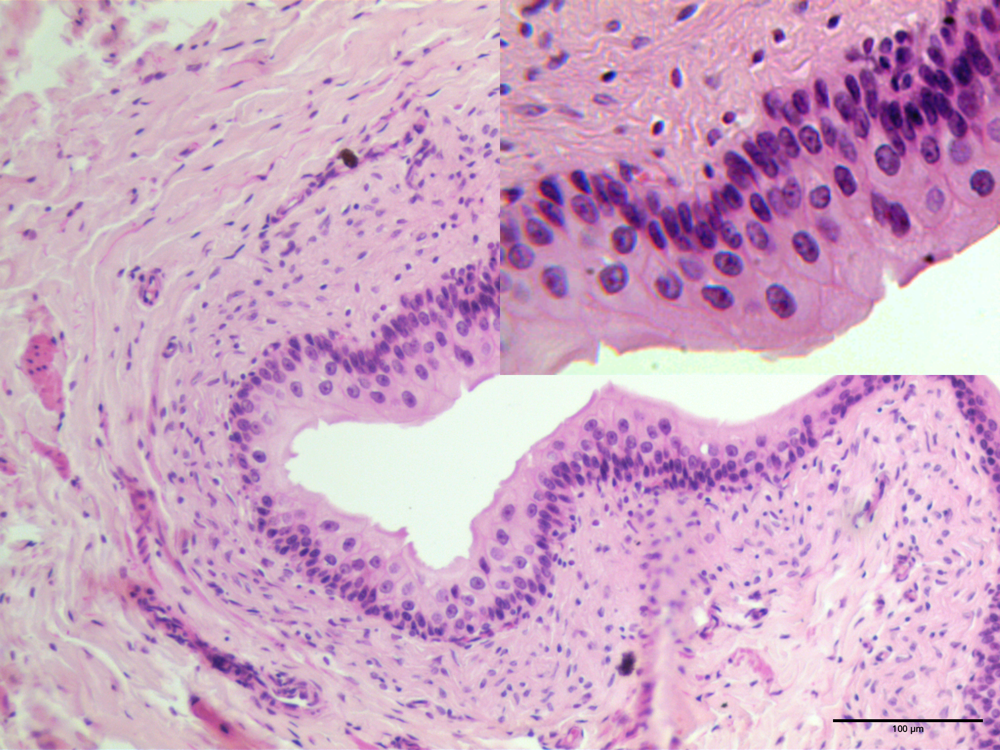

Surface epithelial cells are divided into two broad categories: simple epithelia and stratified epithelia. These are further divided into simple squamous, simple cuboidal, simple columnar and pseudostratified epithelia, and stratified squamous, stratified cuboidal and transitional epithelia.

Figure 1. Simple squamous epithelial cells line a spleenic blood vessel, shown at 10x and 100x magnification with H&E staining. The characteristic flattened shape is distinct.

Simple squamous epithelia are flat, irregular epithelial cells forming a pavement epithelium. They line surfaces used for passive transport such as the lungs and blood vessels, with their flattened morphology reducing the diffusion distance.

Figure 2. Simple cuboidal epithelia line a small pancreatic duct, shown at 10x and 100x magnification with H&E staining.

Simple cuboidal epithelia are roughly square cells that fall between squamous and columnar epithelia. They are mostly found lining small ducts and tubules such as the those of the kidney and the pancreas, where they collect or drain fluids.

Figure 3. Simple columnar epithelia are present in the small intestine, shown at 10x and 100x magnification with H&E staining. Cilia and elongated nuclei are visible at 100x and mucin is present in goblet cells at 10x.

Simple columnar epithelia are tall epithelial cells with elongated nuclei, which line absorptive and secretory surfaces such as the small intestine and the stomach.

Figure 4. Pseudostratified epithelia line the trachea, shown in Masson’s trichrome at 10x and 100x. The cilia and varying nuclear positions are visible at 100x.

Pseudostratified epithelia are a variant of simple columnar epithelia which are typically ciliated and have nuclei at different positions, leading to the appearance of multiple layers of cells. They are found in the respiratory system.

Figure 5. Stratified squamous epithelia are shown in the oesophagus, at 10x and 100x magnification with H&E staining. The dark purple epithelia show the transition from cuboidal cells at the basal surface to squamous cells at the apical surface.

Stratified squamous epithelia are layers of epithelial cells with basal cuboidal cells to an apical flat layer. These are found in tissues which must withstand mechanical abrasion and are kept moist by glands, such as the oesophagus. The epidermis of the skin is composed of keratinised stratified squamous epithelium.

Figure 6. Stratified cuboidal epithelia line a duct in a mammalian submaxillary salivary gland, stained with H&E and shown at 10x and 100x magnification.

Stratified cuboidal epithelia consist of two or three layers of cuboidal cells found around larger excretory ducts such as in the salivary glands, and are used to provide stronger support than a simple epithelium.

Figure 7. The transitional epithelia unique to the urinary system is shown using H&E staining of a mammalian bladder at 10x and 100x magnification.

Transitional epithelia are found in the mammalian urinary tract, and are a form of stratified epithelium able to stretch a large amount. It shares features with both stratified cuboidal and stratified squamous epithelia, and there are distinct morphological changes during distension.

Using information from:
P. Goel, Wheater’s Functional Histology: A text and color atlas, 6th Ed. Journal of Anatomical Sciences 30 (2022).
