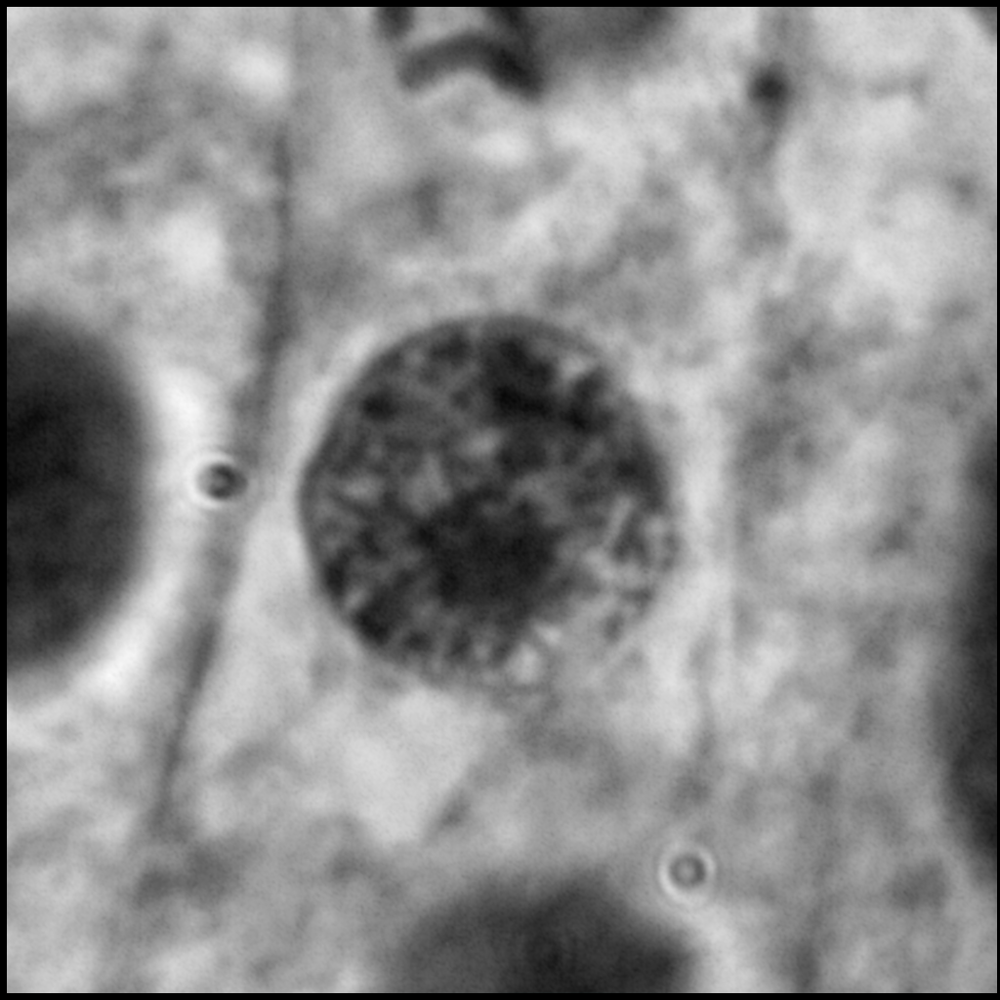
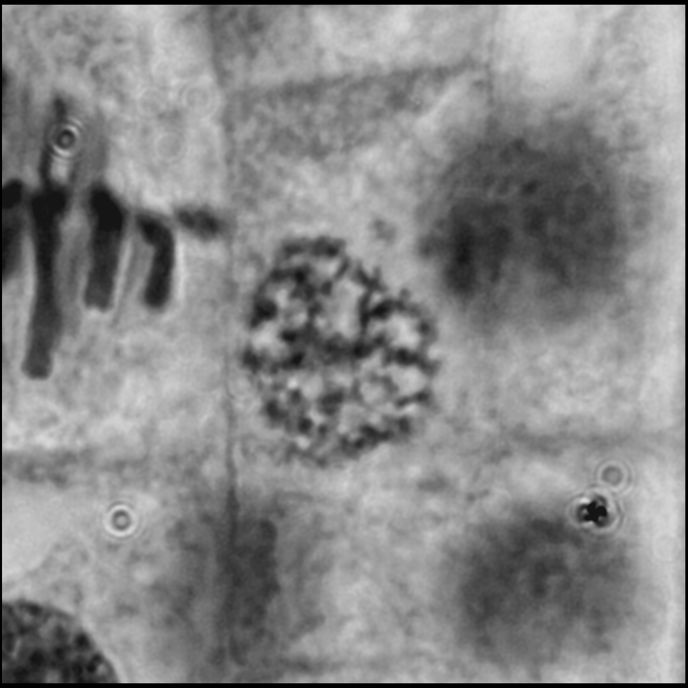
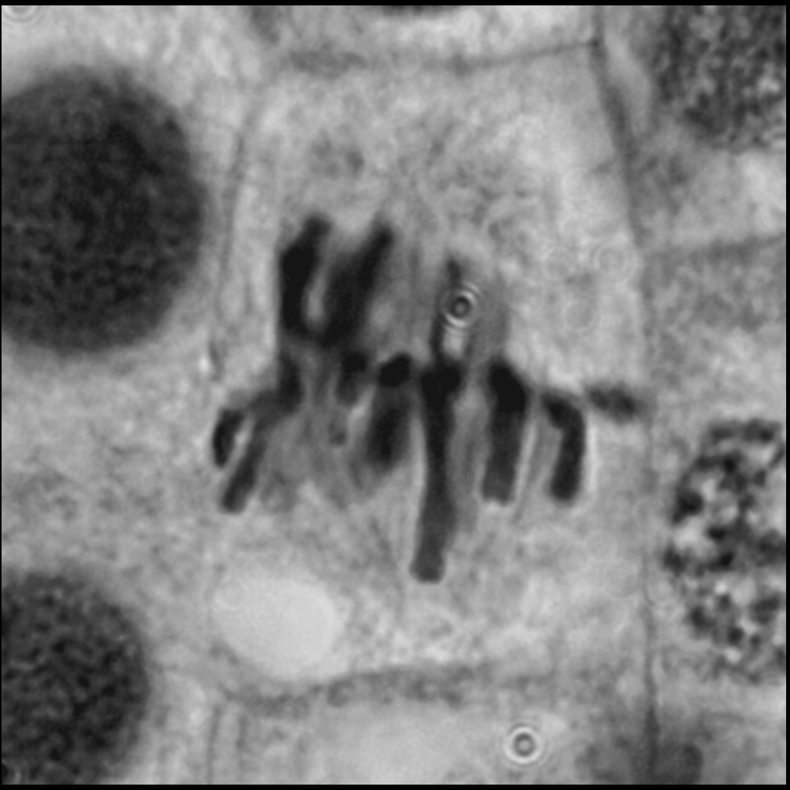
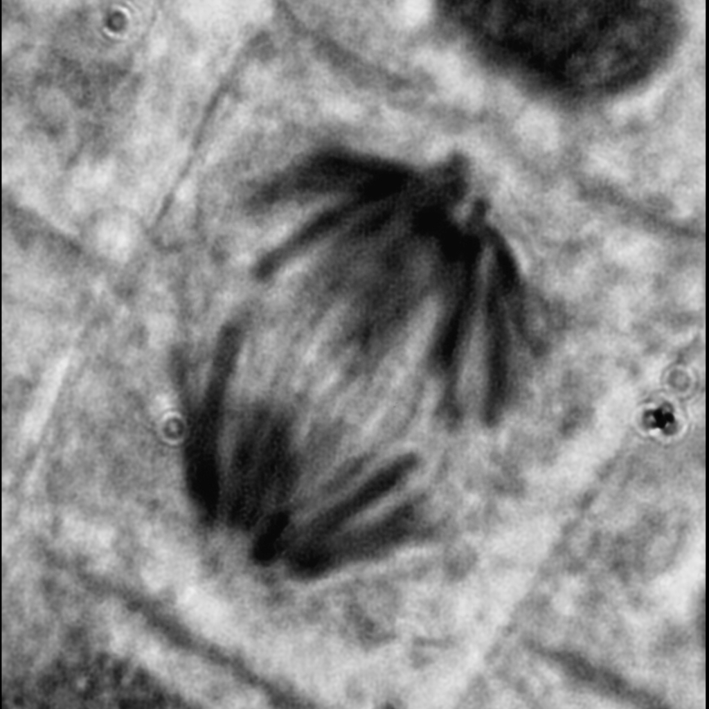
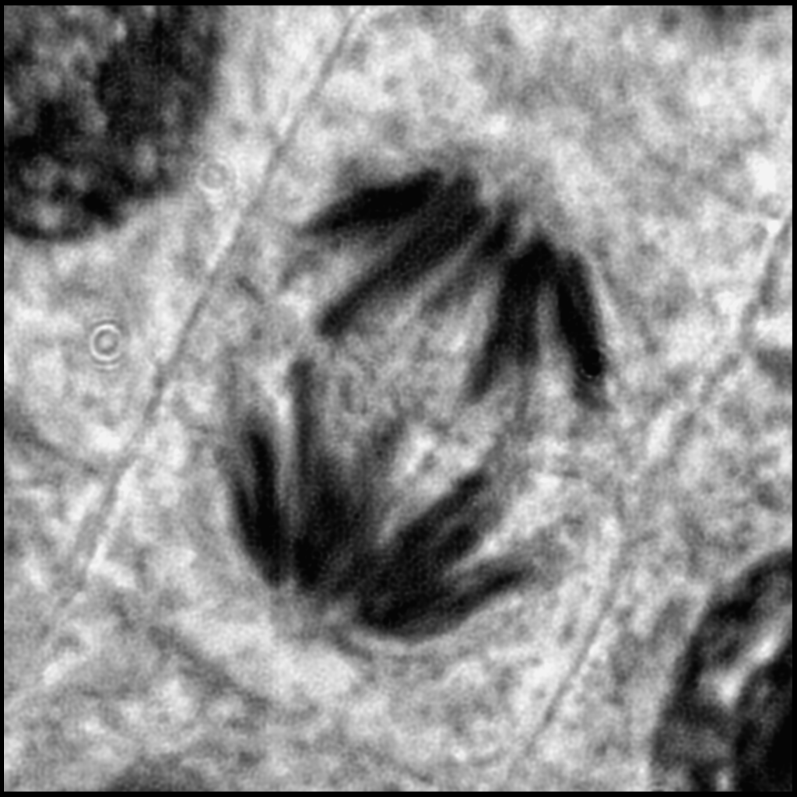
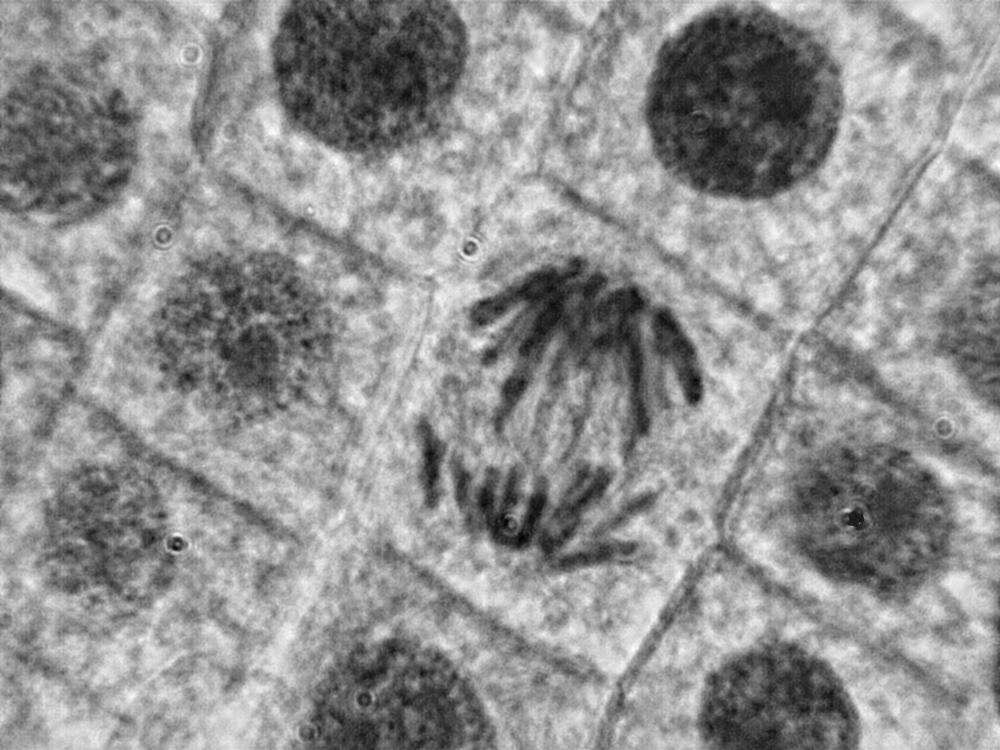
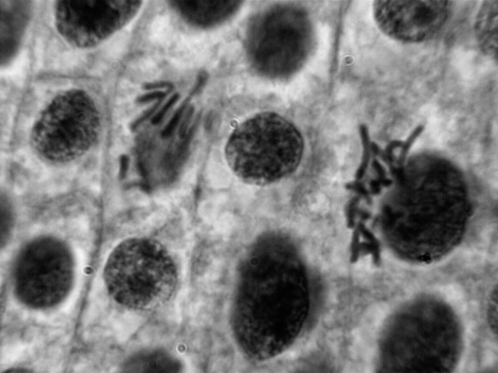
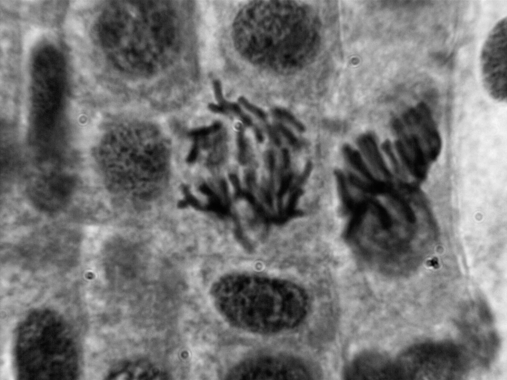
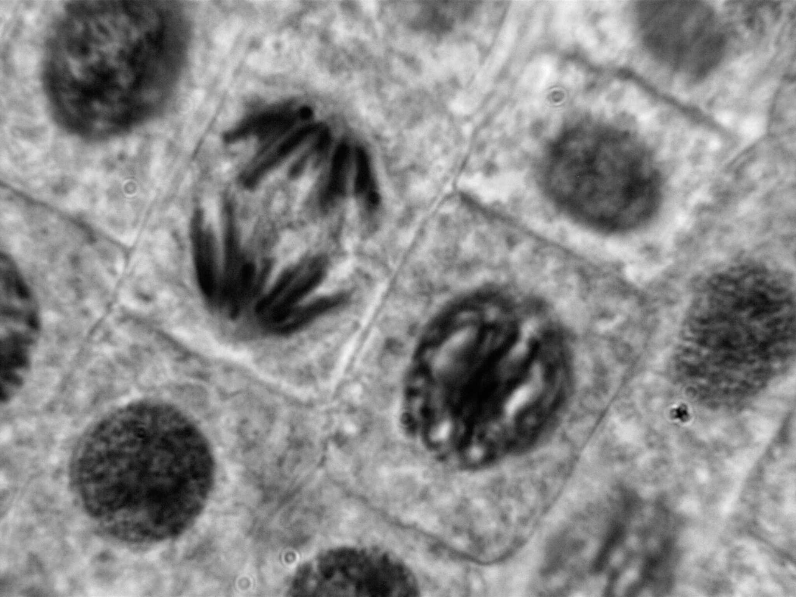

Prepared slides of allium root tip were observed at 100x under oil immersion. Multiple images were stacked to reduce noise and deconvoluted using a calculated PSF to increase the definition and sharpness. 

This image shows each stage of mitosis:

Interphase - chromosomes are decondensed and the cell is proceeding through the G1, S and G2 phases. Proteins and RNA are being synthesised, DNA is replicated and microtubules are produced

Prophase - chromosomes condense to form pairs of sister chromatids. Microtubules grow from the centrosomes to form the mitotic spindle, the nucleolus and nuclear envelope break down.

Metaphase - chromosomes align at the equator of the cell, with microtubules attaching to the kinetochores of each chromosome. In this image, spindle fibres are faintly visible.

Anaphase - sister chromatids separate and are pulled to each pole of the cell by the depolymerising microtubules. In this image, spindle fibres are faintly visible.

Telophase - in this image, the cell plate begins to form and is visible as a faint line between the poles of the cell. The microtubules break down, the nucleoli and nuclear envelopes reform, the chromosomes decondense and the cells split in cytokinesis.

Other interesting observations not included in the above image include:

A cell in anaphase next to a cell in metaphase, contrasting the arrangements of the chromosomes

Another example of anaphase

A cell in anaphase next to a cell in metaphase

A cell in anaphase next to a cell in metaphase

A cell in anaphase next to a cell in prophase with very visibly condensed chromosomes

