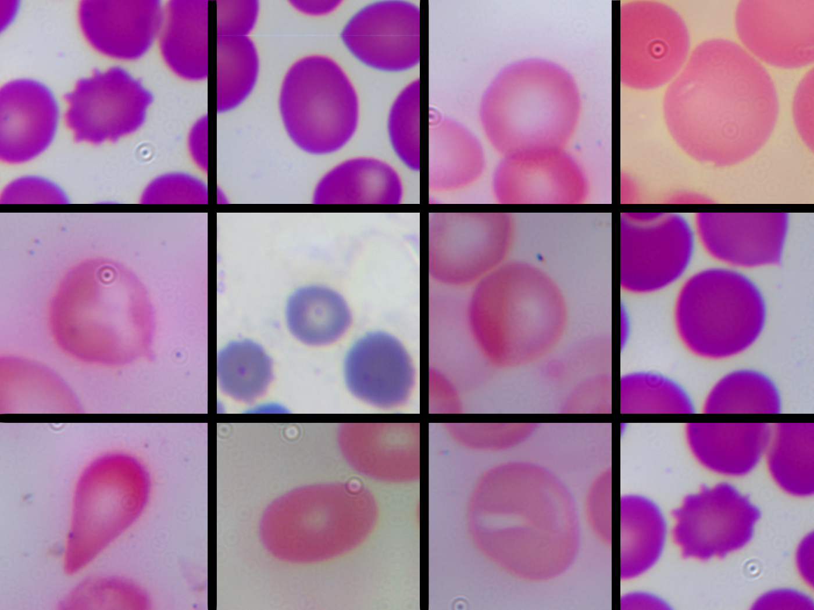
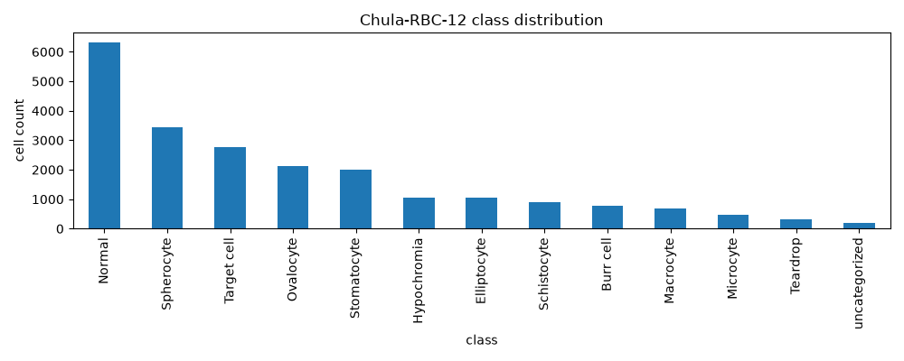
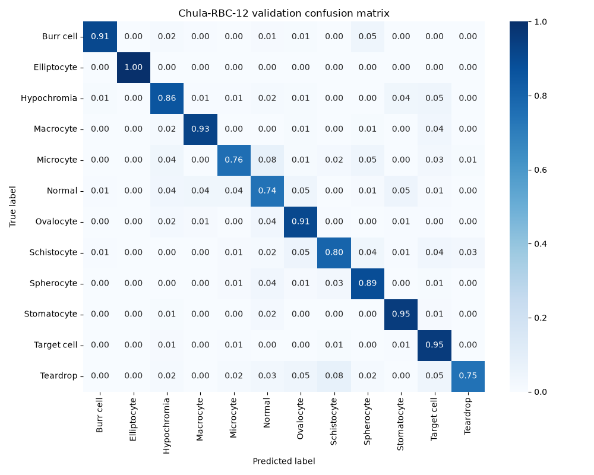
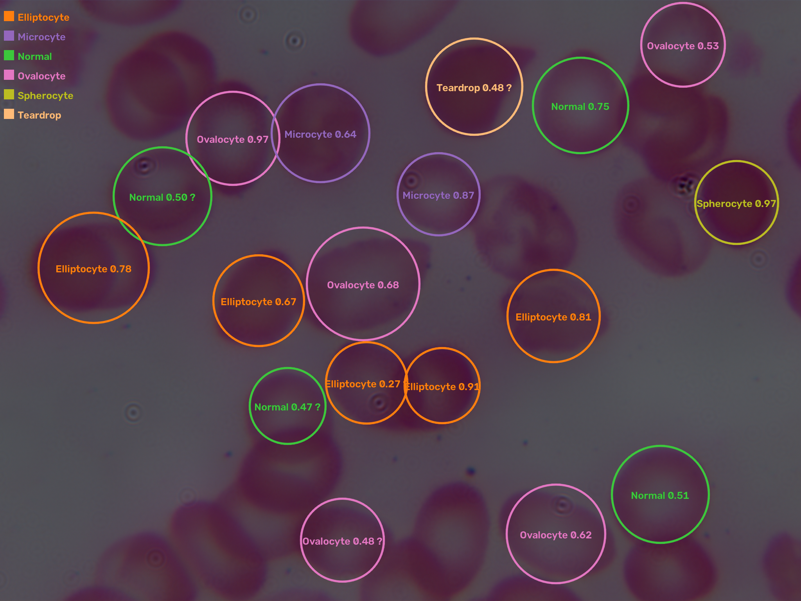
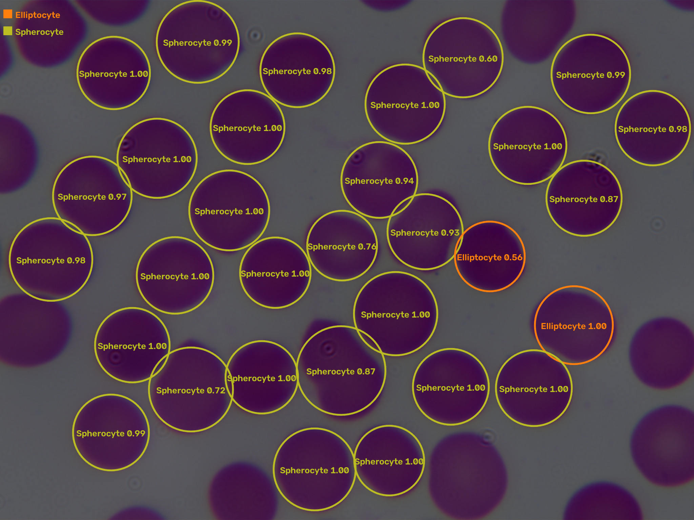
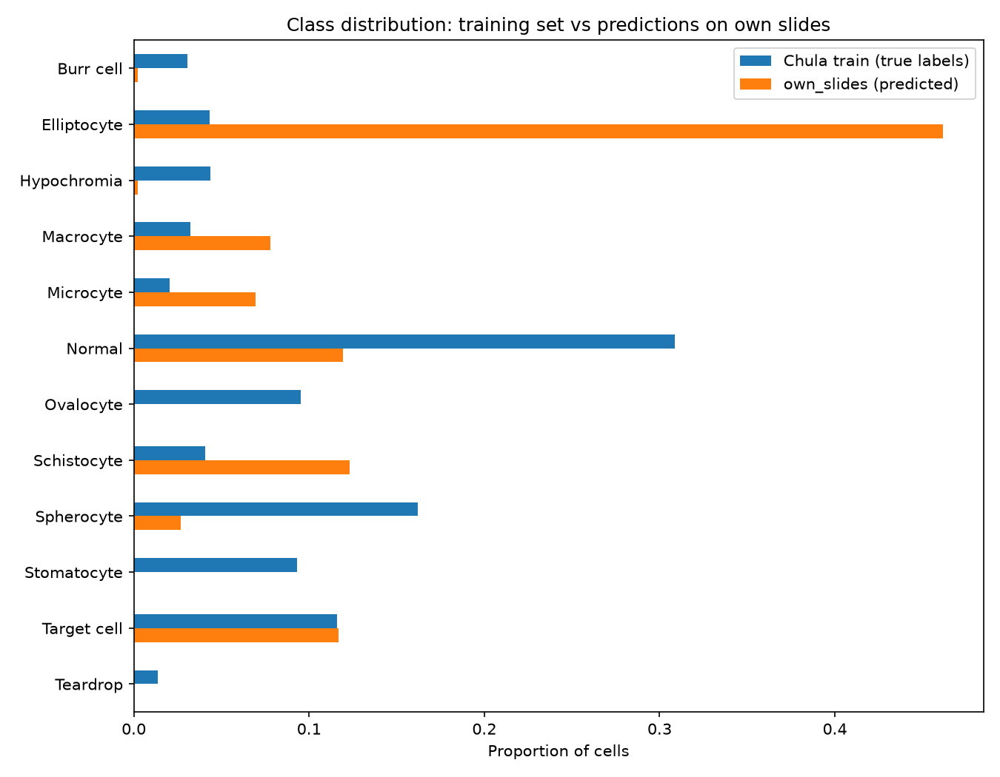
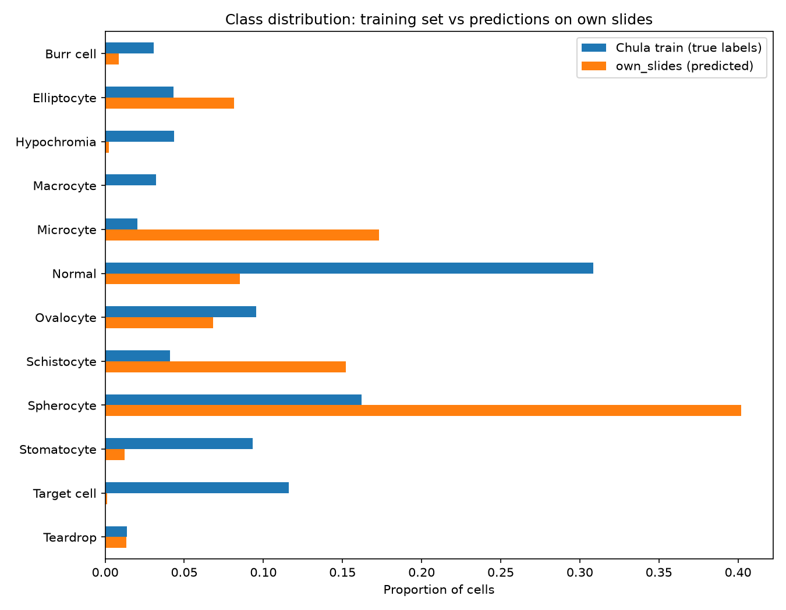
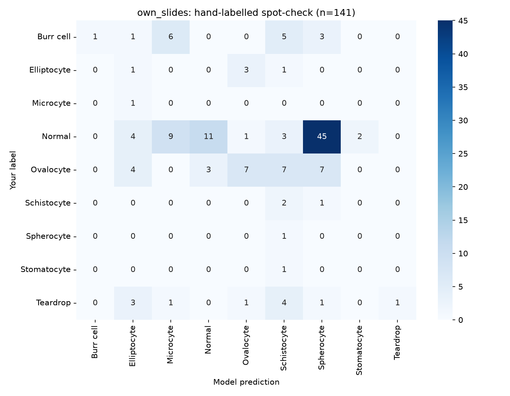

After reading about the use of machine learning algorithms in diagnostics, I found myself wondering whether this was something I could apply to my own slides? My research led me to the Chula-RBC-12 dataset, containing thousands of hand-labelled red blood cells - could I use this dataset to train my own morphology classifier, and would that work on my own slides? The goal of applying them to my own slides was to explore the limitations of many models - they may score well on their own test split, but how robust are they to changes in stains, equipment or conditions? I ultimately built a complete pipeline, taking raw microscope images, segmenting and cropping the images, then classifying them and evaluating the results.

Figure 1. The class distribution of the Chula set. There are approximately 6,000 normal cells,with a 34:1 ratio to the rarest class, the teardrop cell.

Chula-RBC-12 (Naruenatthanaset et al, 2020) is a dataset of 12 classes of point-annotated red blood cells - notably, with a heavy class imbalance, shown in Figure 1. Using a crop size of 80px with 40px either side of the annotated point, in both the x and y axes, the RBCs were cropped so there was a single cell per image and each image was matched to its corresponding label.

Training used an image-level stratified train/val split, to ensure that the training and evaluation sets contained a proportionate amount of each class of RBC. This avoids an entire class, especially the less common ones, appearing entirely in the training set with no evaluation, or the evaluation set having not been trained on them. The base model for the training was cyto3 from Cellpose3 (Stringer and Pachitariu, 2025), and used PyTorch (Paszke et al, 2019). 

Figure 2. The confusion matrix after training on the Chula set. Most classes are accurate, with the lowest accuracy being 0.74, true-normals. 

The accuracy for the baseline model was 0.88, with a macro-F1 of 0.85 and a weighted F1 of 0.88. The confusion matrix is shown in Figure 2, and shows high accuracy with low levels of confusion for each pairing, the highest being 0.08 for true-teardrop schistocytes and true-microcyte normals. Teardrop recall was 0.75 (47 of 63), with errors going to schistocyte, ovalocyte, target cell and normal; this was one class the model struggled with in particular.

My own slides were imaged at 100x magnification with oil immersion, from a variety of sources, with an LCMOS03100KPA camera. It covered several stains, including Leishman's stain, H&E, Wright's stain and Giemsa. 821 crops were used, and they tended to be darker, softer and with a different colour balance to the Chula set. These cells were not labelled before classification, and 150 would later be hand-labelled for evaluation.

Cellpose was used due to the lack of annotations and the use of cell centres for cropping to match the Chula set. Cellpose 3 was used with Cyto3. The cell-probability threshold was -1.0, with an expected diameter of 130px; tiny masks and border-touching cells were removed before cropping. This performed well on dark, in-focus Leihsman monolayers, however it was weaker on the paler, softer cells, and noise often lead to overlapping regions. Overlapping regions were removed as they are out of scope for a single-cell classifier. To ensure the model received inputs the same dimensions as during training, the images were resized to match. Whilst the Chula cells were 35px with a crop size of 80px, the cells in my set were approximately 235px diameter, and were cropped to 300px. A placeholder diameter of 130px was originally used based on the calculated pixel size, however this led to teardrop tails being removed. The 235px was measured from the masks, and used to re-crop the images from the saved centres, which improved the accuracy of normal predictions.

After cropping, segmentation failures such as debris, merged cells or cut-off cells which weren't detected were removed manually. This amounted to 199 crops, primarily due to heavily overlapping cells and debris. Abnormal cells were kept, as identifying these is the primary use of the classifier.

Figure 3a. A prediction overlay showing mostly successful predictions, such as the ovalocyte and elliptocyte in the centre, and the teardrop in the upper right, with confidences between 0.48 to 0.68.

Figure 3b. A predictiom overlay showing unsuccessful predictions, as every single normal cell is miscategorised, most commonly as a spherocyte due to the lack of a distinct lighter central patch.

Figure 4. The class distribution of the Chula set. There are approximately 6,000 normal cells,with a 34:1 ratio to the rarest class, the teardrop cell.

These were then used for training and evaluation. Prediction overlays are shown in Figure 3, with each showing the class and confidence. The class distribution, shown in Figure 4, shows an incredibly high number of elliptocytes and macrocytes compared to the Chula set, with very few normal cells. The model also predicted zero teardrops despite visible examples. A probe indicated the maximum teardrop probability was 0.23, with 2 of 821 cells having a probability >0.05. Two hand-identified teardrops were called elliptocyteswith 1.00 and 0.99 confidence. The 20 highest confidence teardrop calls contained many real teardrops, however elliptocyte and schistocyte had higher confidences. This, combined with the high Chula recall.

The issue was not resolved by resolution matching or crop scale changes, although these improved the accuracy for true-normals. A visual comparison to the Chula set showed different backgrounds, brightnesses, sharpness and colours. Background normalisation changed predictions, however it did not fix the teardrop issue. 

Baseline: 0.75 / 0.89
Blur σ=1: 0.32 / 0.71
Blur σ=2: 0.00 / 0.48
Your exposure: 0.68 / 0.83
Exposure + blur σ=1: 0.24 / 0.54
Exposure + blur σ=2: 0.00 / 0.30
Table 1. The class distribution of the Chula set. There are approximately 6,000 normal cells,with a 34:1 ratio to the rarest class, the teardrop cell.

A robustness probe, the results of which are shown in Table 1, indicated the accuracy drop was coming from the difference in blur between the sets, with mine being significantly softer. The brightness also made a difference, but much smaller than the blur. The etimated blur of my crops was approximately sigma = 0.5px.

A random gaussian blur with a sigma range of 0.2-2.0 was used before resizing, applied 70% of the time. This was combined with higher brightness, contrast, gamma and hue/saturation for retraining. The validation transform was unchanged, so it was still comparable to the Chula set, and the baseline model was kept.

Baseline: 0.83 / 0.88
Blur σ=1: 0.86 / 0.88
Blur σ=2: 0.84 / 0.88
Your exposure: 0.79 / 0.87
Exposure + blur σ=1: 0.81 / 0.87
Exposure + blur σ=2: 0.76 / 0.81
Table 2. The class distribution of the Chula set. There are approximately 6,000 normal cells,with a 34:1 ratio to the rarest class, the teardrop cell.

After the change, Chula evaluation dropped slightly, with an accuracy of 0.87, a macro-F1 of 0.84 and a weighted F1 of 0.87. Teardrop recall increased to 0.83. A robustness probe, shown in Table 2, showed much higher robustness, with an overall accuracy of 0.81 after exposure and blur changes. A probe of the teardrop class showed 11 predicted teardrops, with a maximum confidence of 0.997 and 40 with a confidence >0.05. The named teardrops both had confidences of 0.99.

Figure 5. The class distribution of the Chula set and my own slides after retraining. Spherocytes and microcytes are largely overrepresented, and macrocytes and normal cells and underrepresented.

Figure 5. The confusion matrix of the spot check. The most common pairing is true-normal spherocytes, with the second most common being true-normal normals.

Whilst this improved the results, it still overclassified as spherocyte and microcyte, and underclassified as normal, and likely target cell and macroyte, as shown in Figure 5. To evaluate the overall accuracy of the model, 150 random cells were hand-labelled, blind to the model. Of the 150, 2 were unusable, 7 had 'other' morphologies and 141 were classified. Of those, the accuracy was 0.163 with a bootstrip 95% CI of 0.106-0.227. Balanced accuracy was 0.157 and macro-F1 was 0.126 over the 9 labelled classes. The largest point of confusion, shown in Figure 6, was true-normals being labelled as spherocytes. The most confidence mistakes were predominantly true-normal spherocytes, microcytes, elliptocytes or schistocytes, all of which had confidences of 1.00.

There are several limitations to this:
-There was only one labeller, me, who is a student and not a haematologist, so it is possible the labels were incorrect
-The spot-check was fairly small, and mostly consisted of true-normal cells
-The bootstrap CI treats cells as indepdent, however cells within a slide or of the same stain etc would be correlated, which would inflate the CI
-Due to the small training set of my own slides, none were kept out for testing, so the spot-checked cells were used to tune the model.
-Thick and overlapping regions were excluded
-Several constants such as the cell diameter and crop sizes were estimated and were not entirely consistent across the slides

Naruenatthanaset, K. et al. (2020) “Red Blood Cell Segmentation with Overlapping Cell Separation and Classification on Imbalanced Dataset.” Available at: https://arxiv.org/abs/2012.01321v6 (Accessed: November 4, 2026).

  Paszke, A. et al. (2019) “PyTorch: An Imperative Style, High-Performance Deep Learning Library,” Advances in Neural Information Processing Systems, 32. Available at: https://arxiv.org/abs/1912.01703v1 (Accessed: November 4, 2026).

  Stringer, C. and Pachitariu, M. (2025) “Cellpose3: one-click image restoration for improved cellular segmentation,” Nature Methods 2025 22:3, 22(3), pp. 592–599. Available at: https://doi.org/10.1038/s41592-025-02595-5.
  
