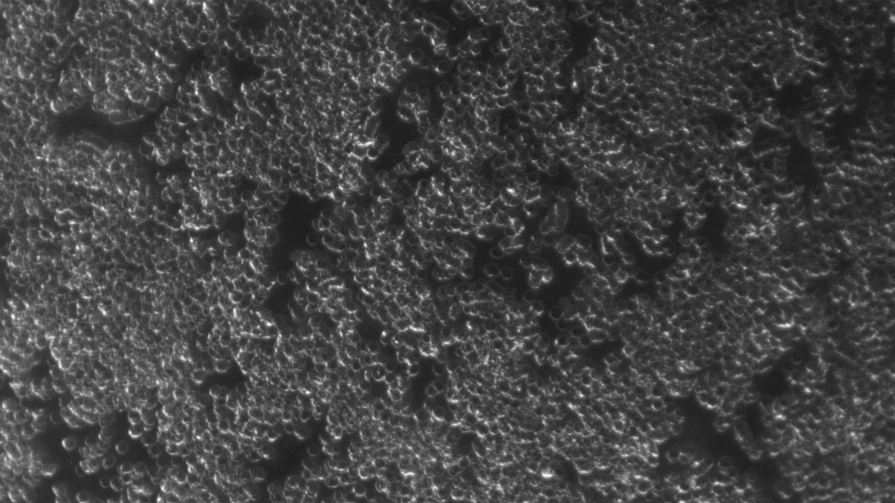
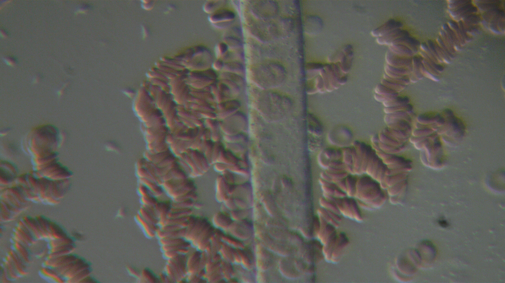
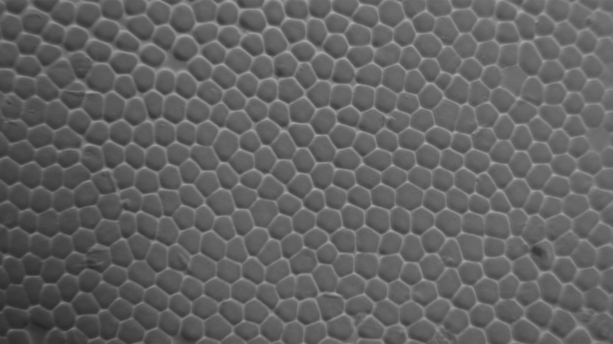
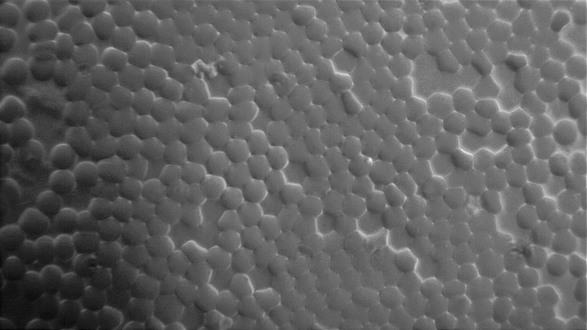

  

Darkfield illumination of a human blood sample at x10 magnification show bright annuli with dark centres. This method enhances contrast and highlights finer structural details, however it is not typically used for diagnostics.

Oblique illumination of a human blood sample alongside a human hair at x40 magnification demonstrates the relative sizes, with red blood cells having a diameter of approximately 7-8μm, and a hair being approximately 20μm wide. Oblique illumination is used to enhance contrast and depth, which is particularly useful in unstained samples, however it leads to heavy chromatic aberration.

Brightfield illumination of a human blood sample at x40 magnification shows cells coalescing into a geometric arrangement. The fluid evaporates from the slide and the cover slip constrains the orientation of the cells, leading to a plane of cells. The densest arrangement of circles is a hexagonal lattice, which is demonstrated by these erythrocytes.

