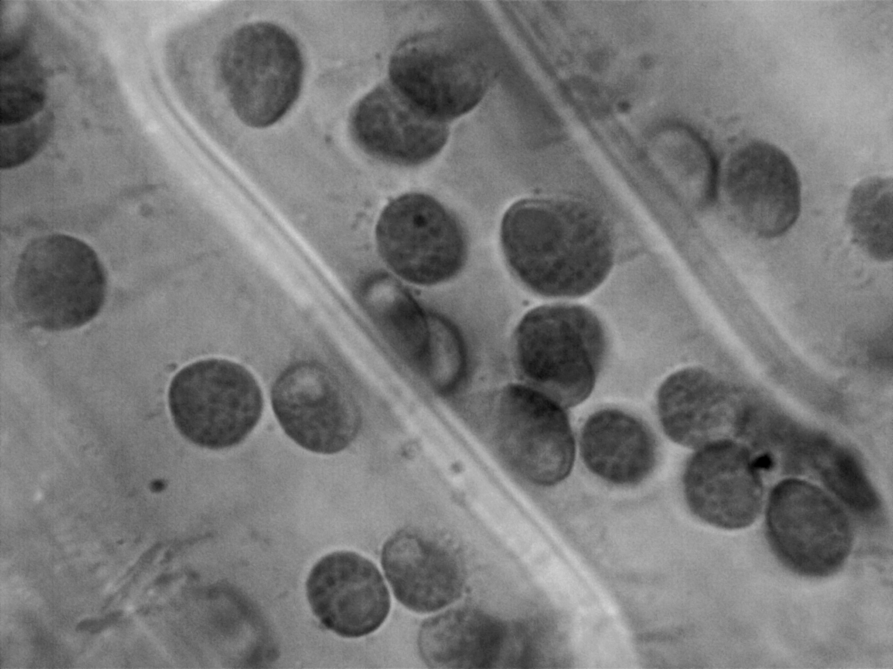
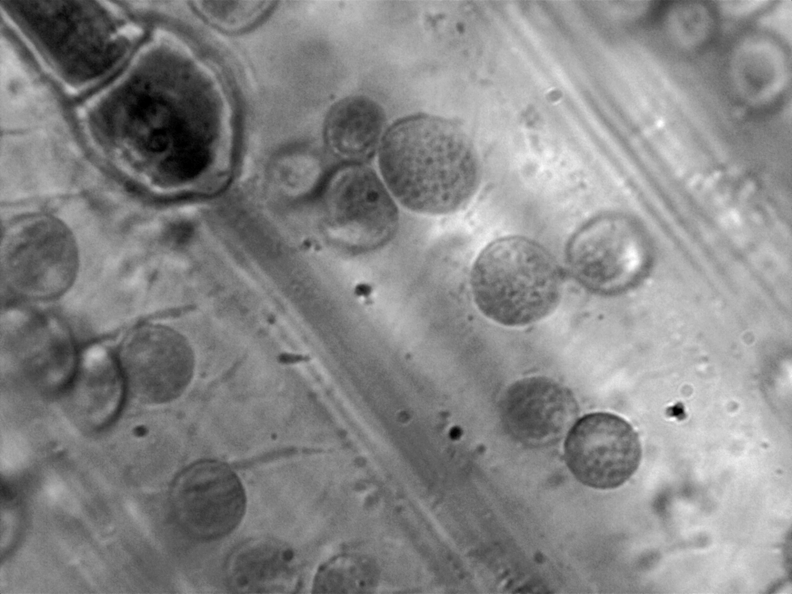

Elodea is a fantastic example of cytoplasmic streaming due to each leaf only being 2 cells thick. 

Cytoplasmic streaming, seen in the video below, is the active, directed flow of the cytoplasm and organelles inside the cell. This is driven by myosin motor proteins along actin filaments, using ATP to circulate organelles and cytoplasm. The purpose of cytoplasmic streaming  to distribute sugar, amino acids, and proteins, whilst clearing waste and overcoming the passive diffusion limit. This video shows it at x100 using oil immersion. 


Using oil immersion, it is also possible to observe the texture and internal structure of chloroplasts. They usually have a large, dark starch granule which is used to temporarily store energy from photosynthesis, although this is not always present. The small circles across the surface of the chloroplasts are grana, which are stacks of thylakoids, membrane sacs which contain chlorophyll for photosynthesis. 

